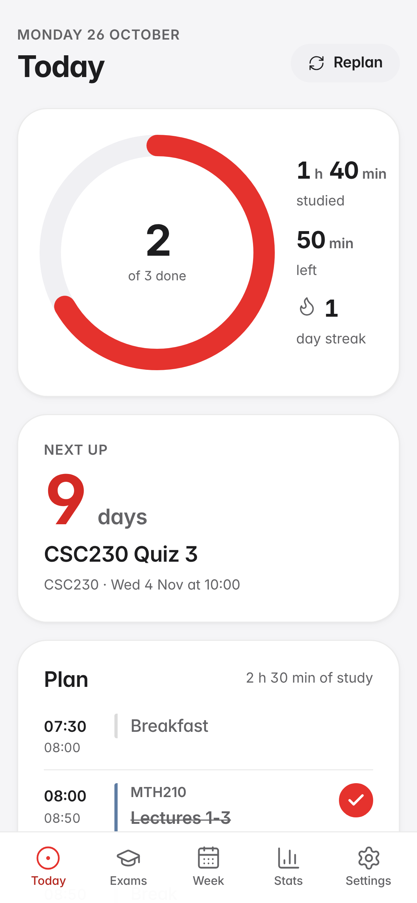
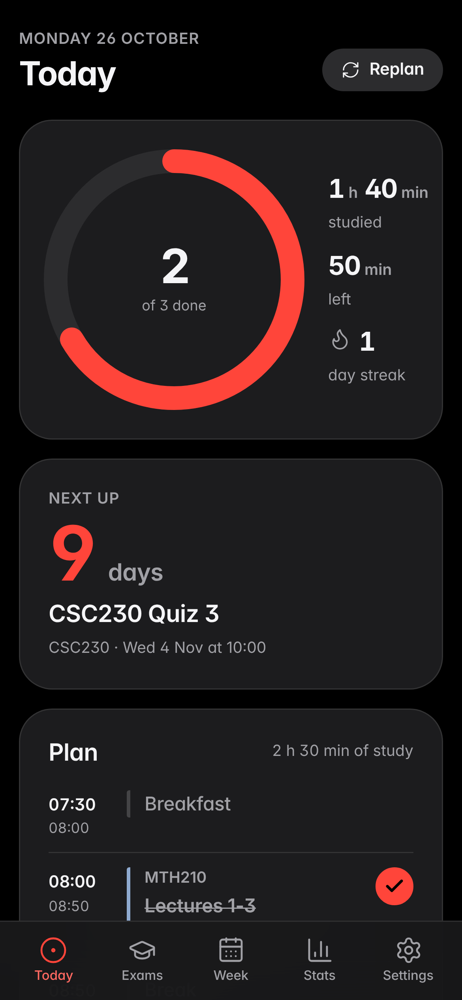
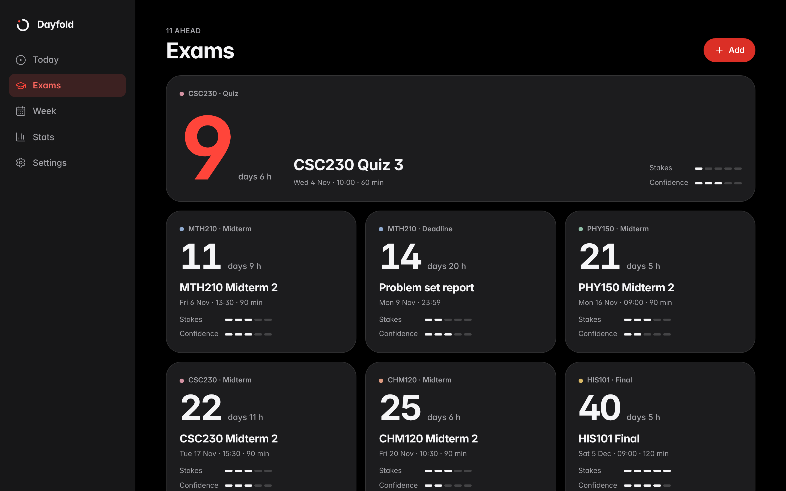
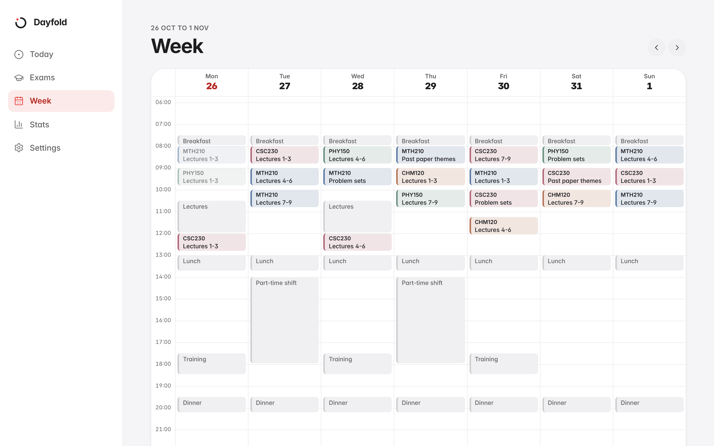
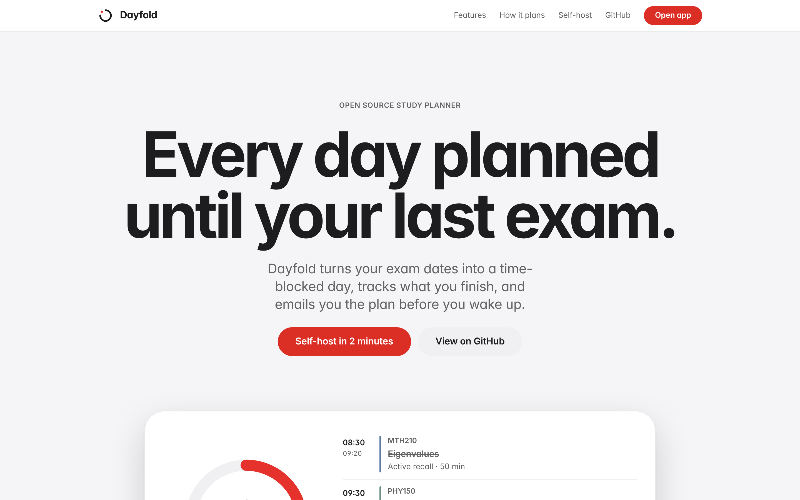

<div align="center">


# Dayfold

**Every day planned until your last exam.**<br/>
A self-hosted study planner. It turns your exam dates into a time-blocked day, tracks what you finish and emails you the plan before you wake up.

 

</div>

## Features

- **A plan for every day**, from wake up to sleep: study sessions, breaks, meals, training and work shifts. Classes and shifts are fixed, study fills the gaps.
- **Exam-aware allocation.** More time goes to exams that are close, high stakes and shaky. The day before an exam is light review. No study during an exam or the hour after. Two exams on one day are handled.
- **Concrete sessions**: course, topic and a method (active recall, practice questions, past papers, association hooks, quiz yourself), with a short note.
- **Never loses work.** Completed sessions are never regenerated, missed ones shift later with higher priority. Replan any time.
- **Countdowns, a progress ring, streaks and stats.**
- **A morning email** with yesterday's recap, today's full timeline and what is coming up (HTML and plain text, light and dark).
- **Installable PWA** for iPhone and Android, with offline-tolerant task ticking.
- **Private.** One user, one SQLite file, no tracking, no paid APIs. The planner is plain deterministic code, not a language model.
- Import exams from **CSV or a calendar file (.ics)**. Works in any timezone.

<p align="center">
 
<br/>
</p>

## Self-host in 2 minutes

### Docker

```bash
git clone https://github.com/karimtelshaarawy/study-planner.git
cd study-planner
cp .env.example .env     # set APP_PASSWORD to a long random string
docker compose up -d
```

Open <http://localhost:3000>. The first run shows a setup wizard. The database lives in the `dayfold-data` Docker volume and, when no email provider is set, emails are written to the `dayfold-outbox` volume (read them with `docker compose cp dayfold:/app/outbox ./outbox`). With plain Node they live in `./data` and `./outbox`.

### Plain Node (20 or newer)

```bash
npm install
cp .env.example .env     # set APP_PASSWORD
npm run build
npm start
```

### Try it with demo data

`npm run seed:demo` loads fictional courses and exams (or press "Use demo data" in the wizard). To load your own schedule from a file, copy `seed/demo.json` to `seed/personal.json` (gitignored), edit it and run `npm run seed:personal`.

## MANUAL STEPS

> **One step needs you: add an email key.** Everything else works without it. Without a key, the daily email is written as an HTML file into `./outbox` and Settings shows a warning.

1. Create a free account at [resend.com](https://resend.com) and make an API key.
2. Put it in `.env` as `RESEND_API_KEY=re_...` and restart.
3. In Settings, enter your address and press **Send test**.

The free sender `onboarding@resend.dev` only delivers to the address that owns the Resend account, which is exactly the single-user case. To send to other addresses, verify a domain in Resend and set `MAIL_FROM`.

Prefer Gmail? Set `SMTP_HOST=smtp.gmail.com`, `SMTP_USER=you@gmail.com` and `SMTP_PASS=<a 16 character app password>` instead.

Never commit `.env`. Every instance needs its own key.

## Configuration

Set in `.env` (see `.env.example`).

| Variable | Default | Purpose |
| --- | --- | --- |
| `APP_PASSWORD` | required | The login password. Use a long random value. |
| `APP_URL` | `http://localhost:PORT` | Public URL, used by the button in the email |
| `RESEND_API_KEY` | empty | Email through Resend |
| `MAIL_FROM` | `Dayfold <onboarding@resend.dev>` | Sender address |
| `SMTP_HOST` `SMTP_PORT` `SMTP_USER` `SMTP_PASS` `SMTP_SECURE` | empty | Email through SMTP |
| `PORT` | `3000` | HTTP port |
| `DATA_DIR` | `data` | SQLite database folder |
| `OUTBOX_DIR` | `outbox` | Where emails go without a provider |
| `SESSION_SECRET` | `APP_PASSWORD` | Signs the session cookie |
| `TRUST_PROXY` | `false` | Set to `true` only behind a reverse proxy you control, so client IPs (login throttle) come from `X-Forwarded-For` |

Everything about you (name, timezone, wake and sleep time, session length, daily cap, meals, commitments, email time) is edited in **Settings**, not in code.

## Use it from your iPhone

The simplest private setup is Docker on a computer that stays on, plus [Tailscale](https://tailscale.com):

```bash
docker compose up -d
tailscale serve --bg 3000          # gives you https://<machine>.<tailnet>.ts.net
```

Set `APP_URL` in `.env` to that address, then open it in Safari on your phone, tap Share and **Add to Home Screen**. The daily email is sent by the server, so the computer needs to be on at the send time. If it was asleep, the missed email goes out once when it wakes up.

Free always-on hosts (Fly.io, Render) work too: deploy the Dockerfile, mount a volume at `/app/data`, and set `APP_PASSWORD` and `APP_URL` as secrets.

## How the planner works

Allocation: `need = (120 + 90 × stakes) × (0.6 + 0.2 × (5 − confidence))` minutes per exam, spread over a prep window that opens `10 + 4 × stakes` days before. A session's priority is the pace still needed (remaining ÷ days left) × stakes, boosted by staleness (a course is never left untouched for more than two days) and carry-over (recently missed work). See [DECISIONS.md](DECISIONS.md) for the full model and the reasoning behind the stack.

`npm run simulate` plans every day from 26 Oct 2026 to the last exam (for the demo data and, if present, your own `seed/personal.json`), also with a late bedtime, a tight daily cap and long sessions, and asserts: no overlapping blocks, no study inside commitments or exam blackouts, every exam has prep, no day above the cap, nothing after a course's last exam.

## Development

```bash
npm run dev            # API :3000 and Vite :5173
npm test               # unit, API, planner and simulation tests
npm run test:e2e       # Playwright end to end
npm run lint && npm run typecheck
npm run screenshots    # regenerates README screenshots from demo data
```

See [CONTRIBUTING.md](CONTRIBUTING.md). Licensed under the [MIT License](LICENSE).
